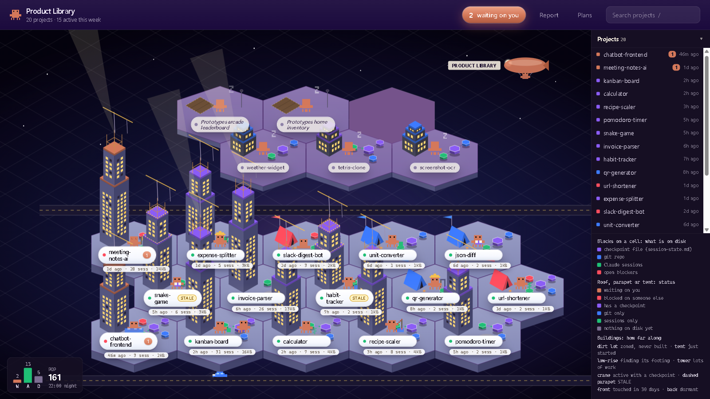

# Product Library



**Every project you've ever started with Claude Code, as a living SimCity-style city.** So none of
your prototypes get lost, and you can see at a glance where you left off and whether your notes
are still true.

> Unofficial project. Not affiliated with or endorsed by Anthropic. "Claude" and "Claude Code" are
> Anthropic's names, used here only to say what this works with.

- **Every project gets a building.** Dirt lot (never got going), tent (just started), low-rise
  (finding its footing), tower (lots of work). Colour is state: clay = a decision waiting on you,
  red = blocked on someone else, violet = has a checkpoint.
- **It notices when your notes lie.** If you commit or work after your last note, the project goes
  STALE and its readiness gate fails.
- **It checks evidence instead of trusting it.** A cited commit must exist in the repo, and a quoted
  sentence must appear word for word in the file it cites.
- **Every building explains itself.** Optional "who it's for" and "why it matters" lines, so a
  project found months later still makes sense.

## Privacy

Runs **entirely on your machine**. It only **reads** what's already on disk (Claude Code's local
session history, git, and one small checkpoint file per project) and never writes to your projects
or to `~/.claude`. The server listens on `127.0.0.1` only. No accounts, no telemetry, no network
calls, no dependencies.

## Quick start

**You need:** Python 3 (tested on 3.13, standard library only, nothing to install), git, and
Claude Code already used on this machine (Product Library reads `~/.claude/projects`).

```bash
git clone https://github.com/xxthemayourxx/product-library.git
cd product-library
```

Start it, then open http://127.0.0.1:7777:

| Windows | macOS / Linux |
|---|---|
| `py coc.py` | `python3 coc.py` |

Want to see it full of buildings first? Run the demo city (20 made-up projects, nothing of yours is
read): `py demo/make_demo.py --serve` on Windows, `python3 demo/make_demo.py --serve` elsewhere.

**Give your projects a checkpoint** (optional, and what makes the city smart). Install the
`/coc-checkpoint` skill by copying its folder into your Claude Code skills:

| Windows (PowerShell) | macOS / Linux |
|---|---|
| `mkdir -Force "$HOME\.claude\skills" > $null; Copy-Item -Recurse skills\coc-checkpoint "$HOME\.claude\skills\"` | `mkdir -p ~/.claude/skills && cp -r skills/coc-checkpoint ~/.claude/skills/` |

Then type `/coc-checkpoint` at the end of a Claude Code session. It drafts a small
`.claude/session-state.md` (stage, next step, proof, blockers, who it's for, why it matters) and
writes it once you approve.

**Platform note:** built and tested on **Windows**. The code is plain cross-platform Python and
should run on macOS and Linux, but that's untested; the "Open in VS Code" button needs the `code`
command on your PATH there. Issues and fixes are welcome.

## Run the checks

    py coc.py --selftest     # assert-based tests, no server, no network (python3 on macOS/Linux)

## Docs

- **[DEMO.md](DEMO.md):** presenting the demo city, with a talk track.
- **[TALK.md](TALK.md):** the 10-minute talk: deck, live demo with the on-screen guide, likely questions.
- **`docs/presentation.html`:** the short talk (what it is, why, lessons, tech). Arrow keys move slides.
- **`docs/lessons-learned.html`:** the deep dive: every technology choice and 33 lessons learned.
- **[SECURITY.md](SECURITY.md):** report vulnerabilities privately. **[LICENSE](LICENSE):** MIT.

(Formerly COC, Center of Claude. Files and env vars keep the `coc` name.)

## Presenting the demo city

    py demo/make_demo.py --serve   # then open http://127.0.0.1:7777

A 20-building demo city covering every state Product Library can show. **[DEMO.md](DEMO.md)** has the
setup, what each hero product demonstrates, a seven-minute talk track and troubleshooting.

## Your settings

Nothing machine-specific lives in the repo. Two environment variables personalise it:

- `COC_OWNER`: the name you write in blockers, e.g. `Sam` for `Sam [S]: pick a vendor`. Blockers
  starting with it count as "waiting on you". Default `Me`, matching `Me [M]: ...`.
- `COC_EXTRA_ROOTS`: extra project folders that have never had a Claude session, separated by `;`
  on Windows.

## Before you push

    py tools/leakcheck.py

It fails on any home-folder path, personal email or private IP in a tracked file. Put words only
you would recognise (your name, real project names) in `LEAK_WORDS`, comma separated, so the list
is never committed: `$env:LEAK_WORDS="name,project"; py tools/leakcheck.py`.

## Offline copy

`poc_city.html` is a standalone copy of the city that opens straight from disk. The copy in this
repo is built from **made-up demo projects** (`tools/demo_data.json`). To build it
from your own projects instead, save your server's `/api/projects` JSON as
`tools/poc_data.json` (git-ignored, never commit it) and run:

    py tools/build_poc.py
    py tools/pocprobe.py   # 53 checks, exits 1 on failure (needs Google Chrome)

Design notes and decisions: `docs/superpowers/specs/`. Project names in comments
and docs are placeholders.
