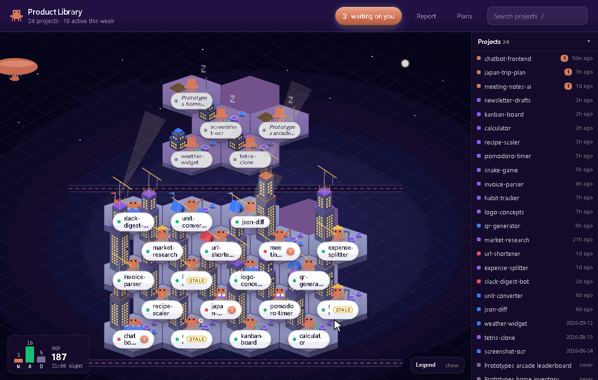

<div align="center">

# Product Library

### Every project you've ever started with Claude Code, as a living SimCity-style city.

**Where did I leave off, and is that note still true?**

[](https://github.com/xKarimAm/product-library/actions/workflows/check.yml)
[](#quick-start)
[](#privacy)
[](SECURITY.md)
[](LICENSE)

[Quick start](#quick-start) · [Privacy](#privacy) · [Sample city](#try-it-with-sample-projects) · [History](#keep-a-history-optional) · [Security](SECURITY.md) · [Contributing](CONTRIBUTING.md)

<br />



</div>

> [!IMPORTANT]
> The official source is [xKarimAm/product-library](https://github.com/xKarimAm/product-library).
> It has no installer, package or binary download. A similar repository name or a copied README
> does not make a download official.

> [!NOTE]
> Unofficial project. Not affiliated with or endorsed by Anthropic. "Claude" and "Claude Code" are
> Anthropic's names, used here only to say what this works with.

---

So none of your prototypes get lost, and you can see at a glance where you left off and whether
your notes are still true.

- **Every project gets a building.** Dirt lot (never got going), tent (just started), low-rise
  (finding its footing), tower (lots of work). Colour is state: clay = a decision waiting on you,
  red = blocked on someone else, violet = has a checkpoint.
- **It notices when your notes lie.** If you commit or work after your last note, the project goes
  STALE and its readiness gate fails.
- **It checks evidence instead of trusting it.** A cited commit must exist in the repo, and a quoted
  sentence must appear word for word in the file it cites.
- **Every building explains itself.** Optional "who it's for" and "why it matters" lines, so a
  project found months later still makes sense.

## Privacy

Runs **entirely on your machine**. It only **reads** what's already on disk (Claude Code's local
session history, git, and one small checkpoint file per project) and never writes to your projects
or to `~/.claude`. The server listens on `127.0.0.1` only. No accounts, no telemetry, no network
calls, no dependencies. The one exception is opt-in: the history below, kept in the app's own folder.

## Quick start

**You need:**

- **Claude Code**, in the terminal or the desktop app's Code tab, already used on this machine.
  Product Library reads its local history in `~/.claude/projects`; chats on claude.ai don't show.
- **Python 3** (tested on 3.12 and 3.13). Standard library only, nothing to install.
- **Git**, only for projects that are code. Folders without git still show.
- **VS Code**, optional, for the "Open in VS Code" button.

**1. Get it**

```bash
git clone https://github.com/xKarimAm/product-library.git
cd product-library
```

**2. Start it**, then open http://127.0.0.1:7777 in your browser:

| Windows | macOS / Linux |
|---|---|
| `py library.py` | `python3 library.py` |

Every folder you have used Claude Code in shows up as a building. Stop it with Ctrl+C.

**3. Give your projects a checkpoint** (optional, and what makes the city smart). Install the
`/library-checkpoint` skill into Claude Code (it copies one folder to `~/.claude/skills`; run it
again after an update):

| Windows | macOS / Linux |
|---|---|
| `py skills/install.py` | `python3 skills/install.py` |

Then type `/library-checkpoint` at the end of a Claude Code session. It drafts a small
`.claude/session-state.md` (stage, next step, proof, blockers, who it's for, why it matters) and
writes it once you approve. Without it projects still show, but their readiness gate can't pass.

**Update** to the latest version any time with `git pull` in the `product-library` folder, then
start it again. Cloned before 23 October 2026? The history was reset that day, so `git pull` fails
once: run `git fetch` then `git reset --hard origin/main` (this drops local edits), or clone again.

**Platform note:** built on **Windows**. Every change runs the tests and builds the sample city on
Windows, macOS and Linux in CI; daily use on macOS and Linux is newer, so reports are welcome. The
"Open in VS Code" button needs the `code` command on your PATH there.

## Try it with sample projects

Want to see a full city before pointing it at your own work? This builds 24 made-up projects
(code and not, with git history, chats and checkpoints) in a folder next to the clone,
`../library-sample`, and starts the app on them. It reads nothing of yours.

| Windows | macOS / Linux |
|---|---|
| `py sample/make_sample.py --serve` | `python3 sample/make_sample.py --serve` |

Then open http://127.0.0.1:7777. Add `--code` to also open every sample project in VS Code, so you
can see the files behind each building. Run `py library.py` again for your own projects.

## Keep a history (optional)

Claude Code clears old chats after a while, and with them a project's story. Start the app with
history on and it keeps a row every time something worth knowing changes: the gate, STALE, the
stage, the next step, the proof, blockers, a commit, a new session or chapter. A live chat alone is
not a change, so an open session does not fill the file.

| Windows | macOS / Linux |
|---|---|
| `py library.py --snapshot` | `python3 library.py --snapshot` |

Each project's **Full view** then has a HISTORY section, newest first. With the server running it
also records every 10 minutes (`LIBRARY_SNAPSHOT_EVERY`, in seconds), even with no browser open. For a
scheduled task instead, `--snapshot --once` records once and exits.

It is one SQLite file, `history.sqlite3`, in `%LOCALAPPDATA%\ProductLibrary` on Windows (or
`~/.local/share/product-library`), or wherever `LIBRARY_DATA_DIR` points. It refuses a folder inside
`~/.claude` or any project. Delete the file to forget everything.

## Run the checks

    py library.py --selftest     # assert-based tests, no server, no network (python3 on macOS/Linux)

## Security, contributing and license

**[SECURITY.md](SECURITY.md):** report vulnerabilities privately. **[CONTRIBUTING.md](CONTRIBUTING.md):**
issues and PRs, AI-assisted welcome. **[LICENSE](LICENSE):** MIT.

## Your settings

Nothing machine-specific lives in the repo. Two environment variables personalise it:

- `LIBRARY_OWNER`: the name you write in blockers, e.g. `Sam` for `Sam [S]: pick a vendor`. Blockers
  starting with it count as "waiting on you". Default `Me`, matching `Me [M]: ...`.
- `LIBRARY_EXTRA_ROOTS`: extra project folders that have never had a Claude session, separated by `;`
  on Windows.

## Before you push

    py tools/leakcheck.py

It fails on any home-folder path, personal email or private IP in a tracked file. Put words only
you would recognise (your name, real project names) in `LEAK_WORDS`, comma separated, so the list
is never committed: `$env:LEAK_WORDS="name,project"; py tools/leakcheck.py`.

## Offline copy

`py tools/build_poc.py` writes `poc_city.html`, a standalone copy of the city that opens straight
from disk. It uses the made-up projects in `tools/sample_data.json`, or your own if you save your
server's `/api/projects` JSON as `tools/poc_data.json` (git-ignored, never commit it).
`py tools/pocprobe.py` runs 53 checks on it (needs Google Chrome).
